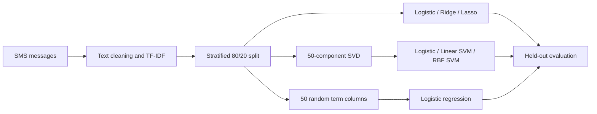

<div align="center">

# SparseSignals

### Regularization, dimension reduction, and kernel methods for SMS classification

**A comparative study of statistical learning on high-dimensional text data.**

[Read the report](reports/SparseSignals.pdf) · [Explore the analysis](analysis/SparseSignals.Rmd) · [Reproduce the study](#reproduce-the-study)


</div>

---

## Overview

SparseSignals examines how regularization, reduced feature spaces, and nonlinear decision boundaries affect SMS spam classification. The study uses **5,572 messages** from the SMS Spam Collection and compares seven model configurations in R.

The central question: **how much predictive information can a model retain as the representation becomes simpler?** The analysis connects text preprocessing and TF–IDF features to model evaluation, with attention to class imbalance and interpretability.

[Methods](#methods) · [Results](#results) · [Reproduction](#reproduce-the-study) · [Repository guide](#repository-guide) · [Scope](#scope-and-interpretation)

## Workflow



## Methods

| Approach | Implementation | Representation |
|:---|:---|:---|
| Logistic regression | `glm`, binomial response | Top 100 training-set terms by summed TF–IDF weight |
| Ridge / lasso | `glmnet`, five-fold cross-validation, `lambda.min` | Full TF–IDF feature matrix |
| Truncated SVD + logistic regression | `irlba`, 50 components | Projection onto training-set singular vectors |
| Random feature subset + logistic regression | 50 randomly selected term columns | A subset of the original features |
| Linear / RBF support vector machines | `e1071::svm` | The 50 SVD components |

Preprocessing converts text to lowercase, removes punctuation, numbers, and English stop words, and strips whitespace. The notebook constructs a TF–IDF document-term matrix and converts it to a dense R matrix for modeling.

## Results

The existing [report](reports/SparseSignals.pdf) records the following held-out accuracies, rounded to three decimals:

| Model | Accuracy |
|:---|---:|
| Logistic regression, 100 terms | 0.927 |
| Ridge | 0.923 |
| **Lasso** | **0.960** |
| SVD + logistic regression | 0.916 |
| Linear SVM on SVD features | 0.913 |
| RBF SVM on SVD features | 0.948 |

Lasso has the highest accuracy among these configurations. The RBF SVM improves on the linear SVM in the reduced feature space. These are results from the recorded experiment, rather than estimates from repeated independent evaluations.

**Interpretation matters:** about 87% of messages are ham, so accuracy alone does not describe spam detection. The notebook also computes precision, recall, and F1, but its linear/logistic models use the default positive class (`ham`), while the SVMs explicitly use `spam`. Those class-specific metrics should be aligned before comparing them across model families.

## Reproduce the study

The PDF is available without running any code. To rerun the notebook:

1. Clone this repository and open R in its root directory.

   ```sh
   git clone https://github.com/JimmyWu-312/SparseSignals.git
   cd SparseSignals
   ```

2. Place the SMS data at `data/spam.csv`. The notebook expects columns `v1` (labels `ham` / `spam`) and `v2` (message text), and converts text from Latin-1 to UTF-8. See the [data guide](data/README.md) for the source and format details.

3. Install the packages loaded by the notebook, plus the renderer:

   ```r
   install.packages(c(
     "rmarkdown", "tidyverse", "tm", "caret", "SnowballC", "glmnet",
     "irlba", "randomForest", "e1071", "kableExtra"
   ))
   ```

4. With Pandoc and a LaTeX installation available, render from the repository root:

   ```r
   rmarkdown::render(
     "analysis/SparseSignals.Rmd",
     output_dir = "reports",
     knit_root_dir = getwd()
   )
   ```

RStudio supplies Pandoc; TinyTeX is one option for LaTeX (`tinytex::install_tinytex()` after installing the `tinytex` R package). Package versions are not pinned, and regenerated outputs may differ from the committed PDF. The notebook fixes the partition seed at `20260416` and the random feature-subset seed at `123`.

## Repository guide

```text
SparseSignals/
├── analysis/
│   └── SparseSignals.Rmd   # Narrative, preprocessing, models, and evaluation
├── data/
│   └── README.md           # Dataset source and required CSV schema
├── reports/
│   └── SparseSignals.pdf  # Existing rendered study
└── README.md
```

## Scope and interpretation

- TF–IDF is constructed on the full corpus before the split. The test set therefore informs the feature representation; fitting the vocabulary and IDF on training data alone would provide a stricter evaluation.
- The notebook calls its random-column baseline “random projection.” It selects existing columns rather than multiplying by a random projection matrix.
- Although the document-term matrix is sparse, the modeling code materializes a dense matrix. This study does not establish an end-to-end sparse-memory implementation or a measured scalability benchmark.
- The comparison uses one train/test partition. No deployment interface or production spam-filtering service is included.

## Author and data credit

**Jimmy Wu** · [GitHub](https://github.com/JimmyWu-312)

The study uses the **SMS Spam Collection**, credited in the report to the UCI Machine Learning Repository. Full methodological references are included in the [report](reports/SparseSignals.pdf).
